# 基于Layui和SpringBoot动漫商城管理的设计与实现--论文

> 🎓 **计算机毕业设计 · 基于Layui和SpringBoot动漫商城管理的设计与实现--论文**
>
> 本仓库只放**项目介绍 + 运行截图**（截图是站点带水印的原图，存在仓库 `images/` 里）。
>
> 👉 **完整可运行源码 / 数据库脚本 / 部署文档：[点我获取](https://geekcode.top/archives/%E5%9F%BA%E4%BA%8ELayui%E5%92%8CSpringBoot%E5%8A%A8%E6%BC%AB%E5%95%86%E5%9F%8E%E7%AE%A1%E7%90%86%E7%9A%84%E8%AE%BE%E8%AE%A1%E4%B8%8E%E5%AE%9E%E7%8E%B0-%E8%AE%BA%E6%96%87?utm_source=github)**
>
> 💬 咨询微信：**ir9372**　|　🌐 更多项目：[极客代码 geekcode.top](https://geekcode.top/?utm_source=github)
>
> 📌 项目详情页：<https://geekcode.top/archives/%E5%9F%BA%E4%BA%8ELayui%E5%92%8CSpringBoot%E5%8A%A8%E6%BC%AB%E5%95%86%E5%9F%8E%E7%AE%A1%E7%90%86%E7%9A%84%E8%AE%BE%E8%AE%A1%E4%B8%8E%E5%AE%9E%E7%8E%B0-%E8%AE%BA%E6%96%87?utm_source=github>

<table><td width="230" align="center"> <b>扫码加微信 ir9372</b></td><td valign="middle">📦 源码 = 项目介绍 + 全部运行截图 + 数据库 + 部署文档 👉 点上方任意截图，直接跳到 <b>极客代码 geekcode.top</b> 详情页</td></table>

---

<h1>基于Layui和SpringBoot动漫商城管理的设计与实现--论文</h1>
<h2>项目概述</h2>

本项目为“基于Layui和SpringBoot动漫商城管理的设计与实现”，旨在构建一个集商品展示、在线交易、资讯发布及后台管理于一体的综合性动漫垂直电商平台。系统采用前后端分离架构，面向动漫爱好者提供商品浏览、购物车管理、订单处理、个人中心及在线咨询等服务；面向管理员提供用户管理、商品维护、订单审核、资讯发布及评论管理等核心运营功能。技术栈以 Spring Boot 为核心后端框架，结合 MyBatis-Plus 进行数据持久化，使用 Shiro 保障系统安全，前端采用 Layui 组件库构建响应式界面。该设计有效解决了传统电商系统在垂直领域内容分发与交互体验上的不足，适用于中小型动漫文化产品的线上销售场景。

<h2>技术架构</h2>
<h3>总体架构</h3>

系统采用经典的 B/S 架构，分为前台用户端、后台管理端及服务层。服务层基于 Java EE 标准开发，通过 RESTful API 与前端进行数据交互。

<a href="https://geekcode.top/archives/%E5%9F%BA%E4%BA%8ELayui%E5%92%8CSpringBoot%E5%8A%A8%E6%BC%AB%E5%95%86%E5%9F%8E%E7%AE%A1%E7%90%86%E7%9A%84%E8%AE%BE%E8%AE%A1%E4%B8%8E%E5%AE%9E%E7%8E%B0-%E8%AE%BA%E6%96%87?utm_source=github" title="查看完整源码">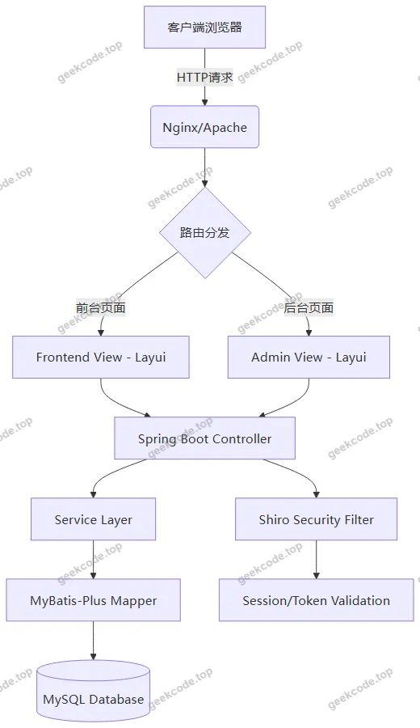</a>

<h3>核心技术选型理由</h3>
<ol>
<li><strong>Spring Boot</strong>：作为微服务基础框架，其自动配置特性简化了 Web 应用搭建，内置 Tomcat 容器便于快速部署，提供了稳定的 MVC 处理能力。</li>
<li><strong>MyBatis-Plus</strong>：在 MyBatis 基础上增强，提供了通用的 CRUD 接口和条件构造器，大幅减少样板代码，提升数据库操作效率，适合高频的数据查询与更新场景。</li>
<li><strong>Apache Shiro</strong>：轻量级安全框架，用于实现身份认证（Authentication）和授权（Authorization）。相比 Spring Security，Shiro 配置更灵活，易于集成到单体应用中，能有效保护后台管理接口及用户隐私数据。</li>
<li><strong>Layui</strong>：前端 UI 框架，提供丰富的模块化组件（如表格、表单、弹窗），无需依赖重型前端构建工具即可快速构建符合审美规范的后台管理系统及简洁的前台页面。</li>
</ol>
<h3>数据库设计要点</h3>

数据库主要实体包括用户（Yonghu）、动漫商品（Dongmanshangpin）、商品类型（Shangpinleixing）、订单（Orders）、地址（Address）、收藏（Storeup）、资讯（News）、评论（Discussdongmanshangpin）及聊天记录（Chat）。所有表均遵循第三范式，通过外键关联确保数据一致性。例如，订单表关联用户ID和商品ID，并记录状态字段以支持订单生命周期管理。

<h2>功能模块</h2>
<h3>前台用户端</h3>

前台主要服务于普通注册用户，提供商品浏览与个人事务管理功能。

<ol>
<li><strong>首页与导航</strong><ul>
<li>展示轮播图广告位。</li>
<li>提供“动漫商品”与“动漫资讯”两大核心入口。</li>
</ul>
</li>
<li><strong>动漫商品模块</strong><ul>
<li><strong>商品列表</strong>：分页展示所有上架动漫周边产品，支持按分类筛选。</li>
<li><strong>商品详情</strong>：展示商品图片、价格、库存、详细描述及所属类型。</li>
<li><strong>商品评论</strong>：查看其他用户对商品的评分与文字评论，支持发表评论。</li>
</ul>
</li>
<li><strong>动漫资讯模块</strong><ul>
<li><strong>资讯列表</strong>：展示最新的动漫行业新闻或活动信息。</li>
<li><strong>资讯详情</strong>：阅读具体文章全文。</li>
</ul>
</li>
<li><strong>个人中心模块</strong><ul>
<li><strong>个人信息</strong>：修改用户名、密码、头像等基础资料。</li>
<li><strong>我的订单</strong>：查看历史订单状态（待支付、已发货等），支持取消订单或确认收货。</li>
<li><strong>我的地址</strong>：管理收货地址，支持新增、编辑、删除及设为默认地址。</li>
<li><strong>我的收藏</strong>：查看收藏的商品列表，支持取消收藏。</li>
</ul>
</li>
<li><strong>购物流程</strong><ul>
<li><strong>购物车</strong>：添加商品至购物车，调整数量，结算生成订单。</li>
</ul>
</li>
<li><strong>互动服务</strong><ul>
<li><strong>在线咨询</strong>：通过聊天窗口与客服或商家进行实时文本沟通。</li>
</ul>
</li>
</ol>
<h3>后台管理端</h3>

后台主要服务于系统管理员，负责平台运营数据的维护与管理。

<ol>
<li><strong>用户管理</strong><ul>
<li>查看注册用户列表，重置用户密码，禁用违规账号。</li>
</ul>
</li>
<li><strong>商品管理</strong><ul>
<li><strong>动漫商品</strong>：增删改查商品信息，上传图片，设置上下架状态。</li>
<li><strong>商品类型</strong>：维护商品分类树，定义类别名称及排序。</li>
</ul>
</li>
<li><strong>订单管理</strong><ul>
<li>查看所有订单，根据状态（未支付、已支付、已发货等）进行筛选。</li>
<li>执行发货操作，修改订单备注，处理退款申请（若存在逻辑）。</li>
</ul>
</li>
<li><strong>内容管理</strong><ul>
<li><strong>动漫资讯</strong>：发布、编辑、删除新闻文章，控制显示顺序。</li>
<li><strong>动漫商品评论</strong>：审核用户评论，删除不良言论，回复用户咨询。</li>
</ul>
</li>
<li><strong>系统配置</strong><ul>
<li><strong>轮播图管理</strong>：上传首页轮播图片，设置跳转链接及显示权重。</li>
<li><strong>参数配置</strong>：修改网站名称、版权信息等全局配置项。</li>
</ul>
</li>
<li><strong>客服管理</strong><ul>
<li><strong>在线咨询</strong>：查看用户发起的会话记录，进行后台回复。</li>
</ul>
</li>
</ol>
<h2>用户角色与权限</h2>

系统基于 Shiro 框架实现细粒度的权限控制，主要包含以下两种角色：

<h3>1. 普通用户 (User)</h3>
<ul>
<li><strong>访问范围</strong>：仅限前台页面及个人中心相关接口。</li>
<li><strong>权限描述</strong>：<ul>
<li>可浏览公开的商品和资讯。</li>
<li>需登录后才能进行加入购物车、下单、收藏、评论及发送咨询消息的操作。</li>
<li>仅能查看和管理自己的订单、地址、收藏及聊天记录。</li>
<li>无法访问任何 <code>/admin</code> 路径下的后台管理功能。</li>
</ul>
</li>
</ul>
<h3>2. 管理员 (Admin)</h3>
<ul>
<li><strong>访问范围</strong>：后台管理系统 (<code>/news</code>, <code>/dongmanshangpin</code>, <code>/yonghu</code> 等路由)。</li>
<li><strong>权限描述</strong>：<ul>
<li>拥有最高权限，可对系统中所有数据进行 CRUD（增删改查）操作。</li>
<li>管理用户账户状态。</li>
<li>全面管控商品、分类、订单、资讯、评论及轮播图资源。</li>
<li>可查看全量聊天记录并进行回复。</li>
<li>登录后台需经过严格的身份验证。</li>
</ul>
</li>
</ul>
<h2>项目特色与创新点</h2>
<ol>
<li><strong>垂直领域定制化设计</strong>：针对动漫市场特点，专门设计了“动漫资讯”与“动漫商品”双核驱动模式，不仅满足交易需求，还通过资讯内容增强用户粘性，形成“内容+电商”的闭环生态。</li>
<li><strong>轻量化高效开发架构</strong>：采用 Spring Boot + MyBatis-Plus + Layui 的组合，摒弃了复杂的前端构建流程，实现了快速开发与低维护成本。Layui 提供的丰富组件使得后台管理界面在短时间内达到专业级视觉效果。</li>
<li><strong>完善的互动与服务体系</strong>：集成了“在线咨询”模块，允许用户在前台直接发起会话，管理员在后台回复，提升了售后服务的即时性。同时，“商品评论”模块支持双向互动，增强了社区属性。</li>
<li><strong>安全性与稳定性并重</strong>：引入 Apache Shiro 进行统一的安全管控，有效防止越权访问和数据泄露。MyBatis-Plus 的乐观锁机制（若启用）及事务管理保障了订单扣减库存等高并发场景下的数据一致性。</li>
</ol>
<h2>部署环境</h2>

为确保系统正常运行，需准备以下软硬件环境：

<ol>
<li><strong>操作系统</strong>：Windows 10/11, Linux (CentOS 7+, Ubuntu 18.04+) 或 macOS。</li>
<li><strong>Java 环境</strong>：JDK 1.8 或更高版本（推荐 JDK 1.8 以保证兼容性）。</li>
<li><strong>数据库</strong>：MySQL 5.7 或 MySQL 8.0，需初始化项目提供的 SQL 脚本以创建表结构和基础数据。</li>
<li><strong>Web 服务器</strong>：内置于 Spring Boot 的 Tomcat，或独立部署 Nginx 作为反向代理。</li>
<li><strong>浏览器</strong>：Chrome, Edge, Firefox 等现代主流浏览器（建议版本较新以支持 HTML5/CSS3 特性）。</li>
<li><strong>开发工具</strong>（可选，用于二次开发）：IntelliJ IDEA 或 Eclipse，Maven 3.6+ 用于依赖管理。</li>
</ol>
<h2>五、技术特性</h2>
<ul>
<li>前后端集成部署，前端资源打包至后端 static 目录</li>
<li>使用 MyBatis-Plus 简化数据访问层开发</li>
<li>集成 Shiro 权限框架实现角色权限控制</li>
</ul>
<h2>六、功能模块截图</h2>
<h3>前台用户端</h3>
<h4>前台首页</h4>

<a href="https://geekcode.top/archives/%E5%9F%BA%E4%BA%8ELayui%E5%92%8CSpringBoot%E5%8A%A8%E6%BC%AB%E5%95%86%E5%9F%8E%E7%AE%A1%E7%90%86%E7%9A%84%E8%AE%BE%E8%AE%A1%E4%B8%8E%E5%AE%9E%E7%8E%B0-%E8%AE%BA%E6%96%87?utm_source=github" title="查看完整源码">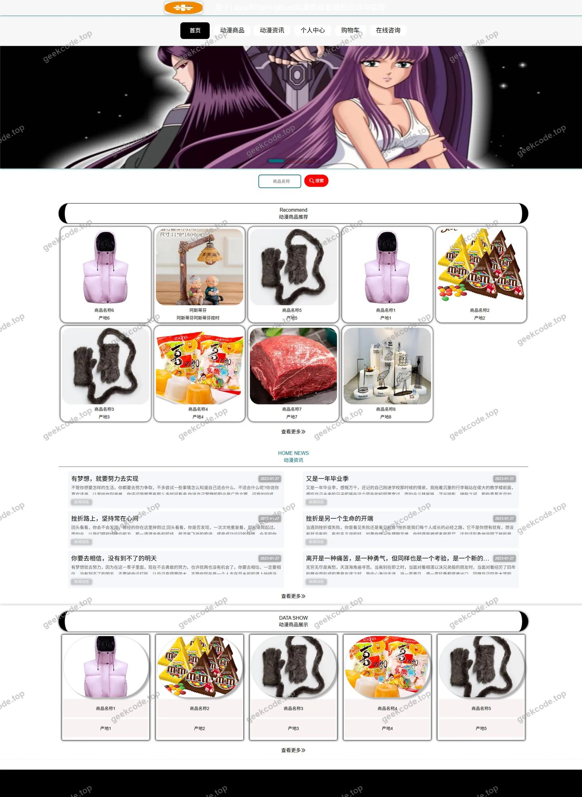</a>

<h4>前台登录页</h4>

<a href="https://geekcode.top/archives/%E5%9F%BA%E4%BA%8ELayui%E5%92%8CSpringBoot%E5%8A%A8%E6%BC%AB%E5%95%86%E5%9F%8E%E7%AE%A1%E7%90%86%E7%9A%84%E8%AE%BE%E8%AE%A1%E4%B8%8E%E5%AE%9E%E7%8E%B0-%E8%AE%BA%E6%96%87?utm_source=github" title="查看完整源码">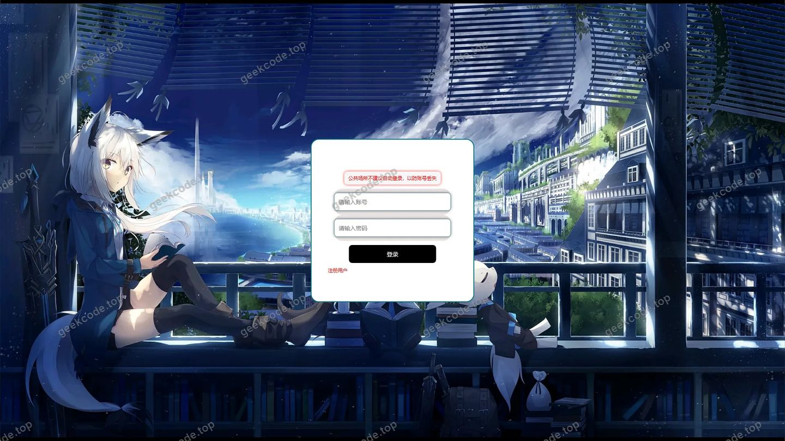</a>

<h4>前台注册页</h4>

<a href="https://geekcode.top/archives/%E5%9F%BA%E4%BA%8ELayui%E5%92%8CSpringBoot%E5%8A%A8%E6%BC%AB%E5%95%86%E5%9F%8E%E7%AE%A1%E7%90%86%E7%9A%84%E8%AE%BE%E8%AE%A1%E4%B8%8E%E5%AE%9E%E7%8E%B0-%E8%AE%BA%E6%96%87?utm_source=github" title="查看完整源码">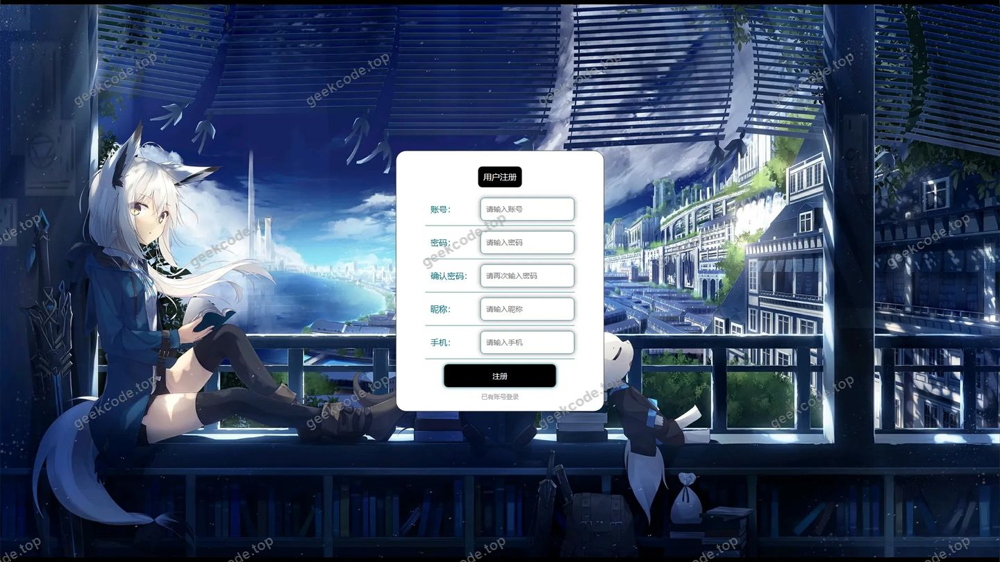</a>

<h4>前台-动漫商品列表</h4>

<a href="https://geekcode.top/archives/%E5%9F%BA%E4%BA%8ELayui%E5%92%8CSpringBoot%E5%8A%A8%E6%BC%AB%E5%95%86%E5%9F%8E%E7%AE%A1%E7%90%86%E7%9A%84%E8%AE%BE%E8%AE%A1%E4%B8%8E%E5%AE%9E%E7%8E%B0-%E8%AE%BA%E6%96%87?utm_source=github" title="查看完整源码">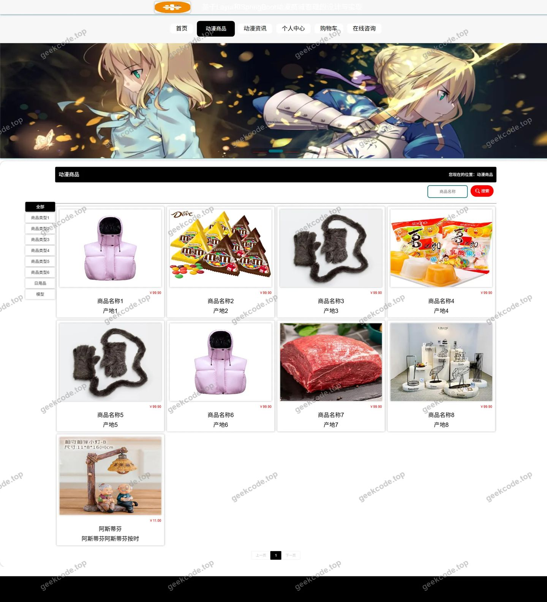</a>

<h4>前台-动漫资讯列表</h4>

<a href="https://geekcode.top/archives/%E5%9F%BA%E4%BA%8ELayui%E5%92%8CSpringBoot%E5%8A%A8%E6%BC%AB%E5%95%86%E5%9F%8E%E7%AE%A1%E7%90%86%E7%9A%84%E8%AE%BE%E8%AE%A1%E4%B8%8E%E5%AE%9E%E7%8E%B0-%E8%AE%BA%E6%96%87?utm_source=github" title="查看完整源码">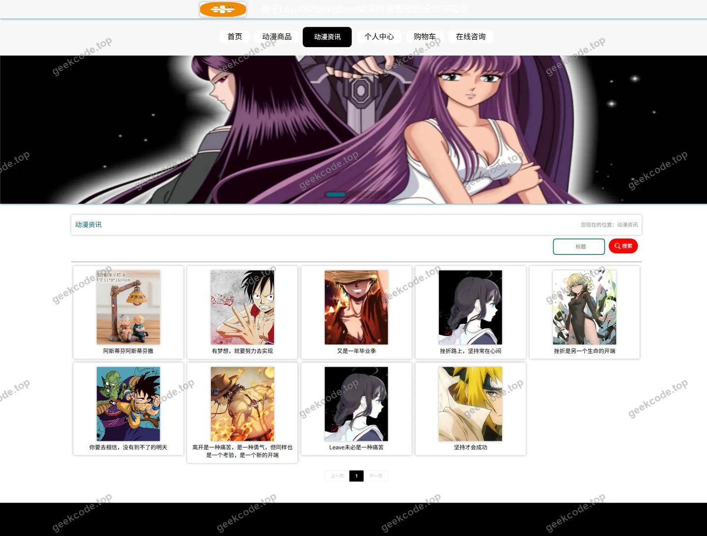</a>

<h4>前台-我的订单列表</h4>

<a href="https://geekcode.top/archives/%E5%9F%BA%E4%BA%8ELayui%E5%92%8CSpringBoot%E5%8A%A8%E6%BC%AB%E5%95%86%E5%9F%8E%E7%AE%A1%E7%90%86%E7%9A%84%E8%AE%BE%E8%AE%A1%E4%B8%8E%E5%AE%9E%E7%8E%B0-%E8%AE%BA%E6%96%87?utm_source=github" title="查看完整源码">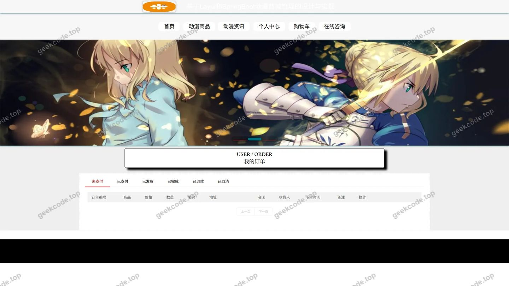</a>

<h4>前台-我的收藏列表</h4>

<a href="https://geekcode.top/archives/%E5%9F%BA%E4%BA%8ELayui%E5%92%8CSpringBoot%E5%8A%A8%E6%BC%AB%E5%95%86%E5%9F%8E%E7%AE%A1%E7%90%86%E7%9A%84%E8%AE%BE%E8%AE%A1%E4%B8%8E%E5%AE%9E%E7%8E%B0-%E8%AE%BA%E6%96%87?utm_source=github" title="查看完整源码">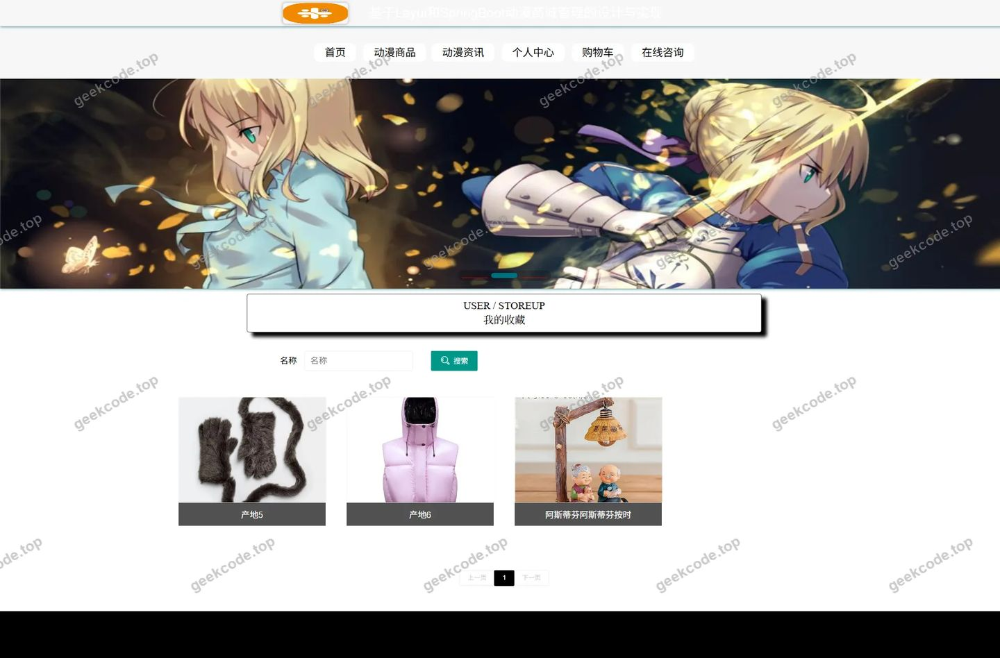</a>

<h4>前台-动漫商品评论列表</h4>

<a href="https://geekcode.top/archives/%E5%9F%BA%E4%BA%8ELayui%E5%92%8CSpringBoot%E5%8A%A8%E6%BC%AB%E5%95%86%E5%9F%8E%E7%AE%A1%E7%90%86%E7%9A%84%E8%AE%BE%E8%AE%A1%E4%B8%8E%E5%AE%9E%E7%8E%B0-%E8%AE%BA%E6%96%87?utm_source=github" title="查看完整源码">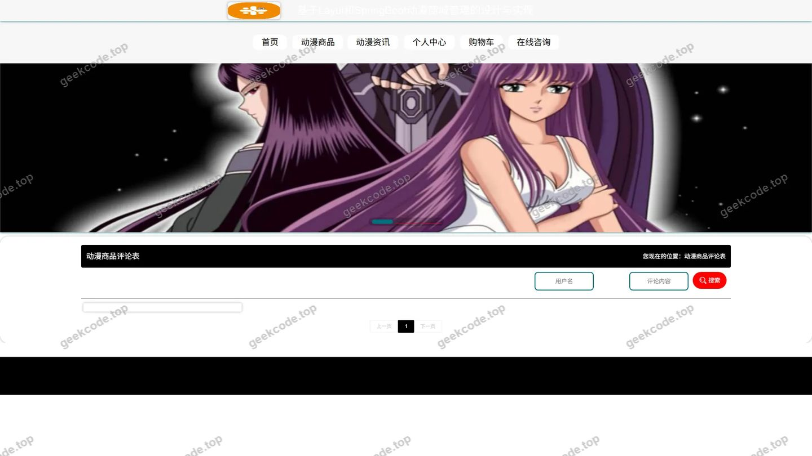</a>

<h4>前台-商品类型列表</h4>

<h4>前台-购物车列表</h4>

<a href="https://geekcode.top/archives/%E5%9F%BA%E4%BA%8ELayui%E5%92%8CSpringBoot%E5%8A%A8%E6%BC%AB%E5%95%86%E5%9F%8E%E7%AE%A1%E7%90%86%E7%9A%84%E8%AE%BE%E8%AE%A1%E4%B8%8E%E5%AE%9E%E7%8E%B0-%E8%AE%BA%E6%96%87?utm_source=github" title="查看完整源码">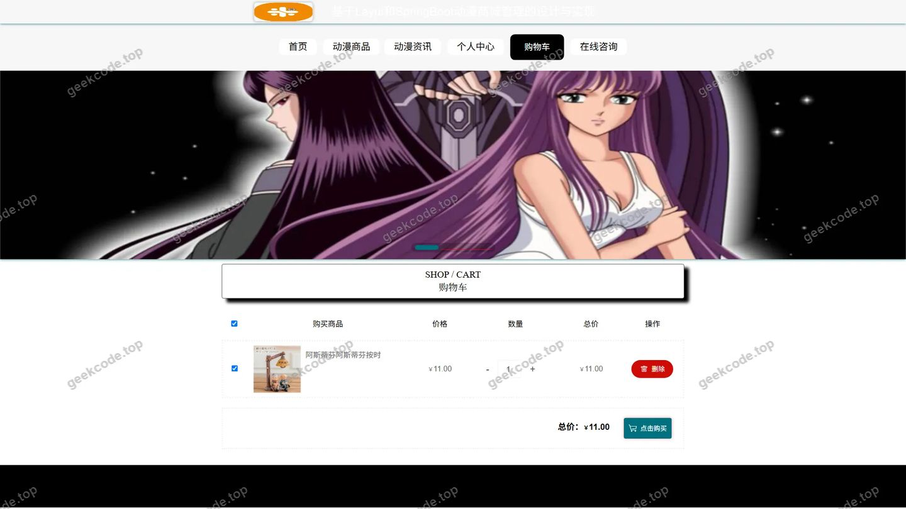</a>

<h4>前台个人中心</h4>

<a href="https://geekcode.top/archives/%E5%9F%BA%E4%BA%8ELayui%E5%92%8CSpringBoot%E5%8A%A8%E6%BC%AB%E5%95%86%E5%9F%8E%E7%AE%A1%E7%90%86%E7%9A%84%E8%AE%BE%E8%AE%A1%E4%B8%8E%E5%AE%9E%E7%8E%B0-%E8%AE%BA%E6%96%87?utm_source=github" title="查看完整源码">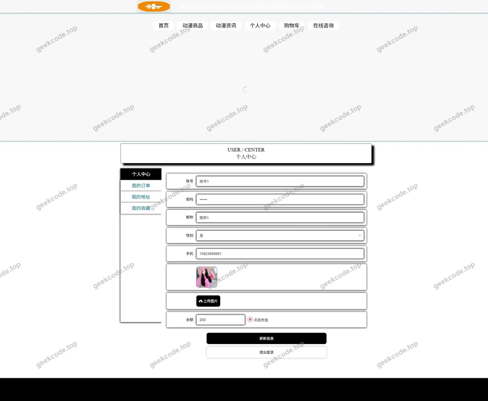</a>

<h4>前台-我的地址列表</h4>

<a href="https://geekcode.top/archives/%E5%9F%BA%E4%BA%8ELayui%E5%92%8CSpringBoot%E5%8A%A8%E6%BC%AB%E5%95%86%E5%9F%8E%E7%AE%A1%E7%90%86%E7%9A%84%E8%AE%BE%E8%AE%A1%E4%B8%8E%E5%AE%9E%E7%8E%B0-%E8%AE%BA%E6%96%87?utm_source=github" title="查看完整源码">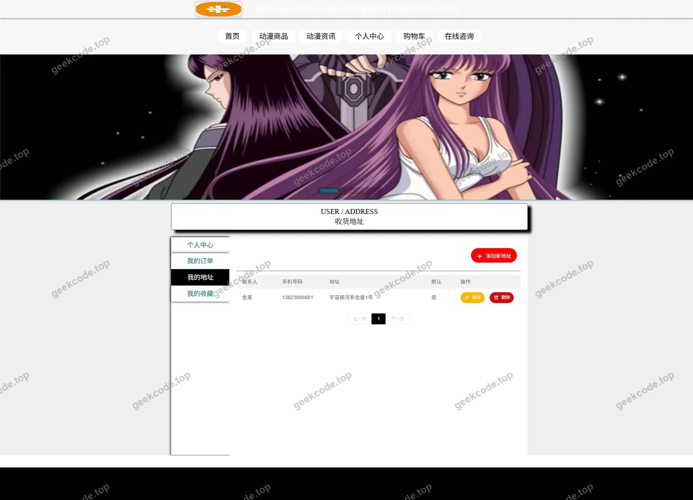</a>

<h4>前台-动漫商品-详情</h4>

<a href="https://geekcode.top/archives/%E5%9F%BA%E4%BA%8ELayui%E5%92%8CSpringBoot%E5%8A%A8%E6%BC%AB%E5%95%86%E5%9F%8E%E7%AE%A1%E7%90%86%E7%9A%84%E8%AE%BE%E8%AE%A1%E4%B8%8E%E5%AE%9E%E7%8E%B0-%E8%AE%BA%E6%96%87?utm_source=github" title="查看完整源码">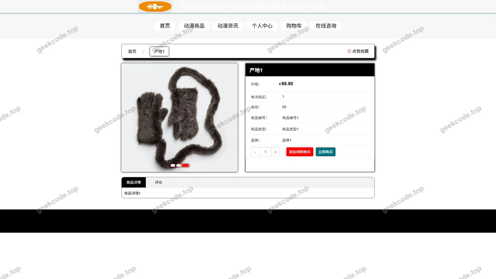</a>

<h4>前台-动漫资讯-详情</h4>

<a href="https://geekcode.top/archives/%E5%9F%BA%E4%BA%8ELayui%E5%92%8CSpringBoot%E5%8A%A8%E6%BC%AB%E5%95%86%E5%9F%8E%E7%AE%A1%E7%90%86%E7%9A%84%E8%AE%BE%E8%AE%A1%E4%B8%8E%E5%AE%9E%E7%8E%B0-%E8%AE%BA%E6%96%87?utm_source=github" title="查看完整源码">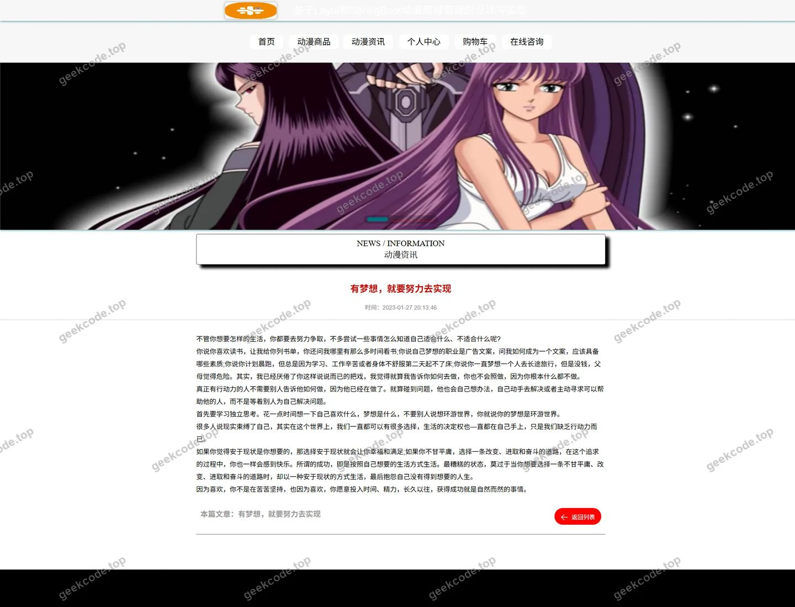</a>

<h4>前台-动漫商品评论-详情</h4>

<a href="https://geekcode.top/archives/%E5%9F%BA%E4%BA%8ELayui%E5%92%8CSpringBoot%E5%8A%A8%E6%BC%AB%E5%95%86%E5%9F%8E%E7%AE%A1%E7%90%86%E7%9A%84%E8%AE%BE%E8%AE%A1%E4%B8%8E%E5%AE%9E%E7%8E%B0-%E8%AE%BA%E6%96%87?utm_source=github" title="查看完整源码">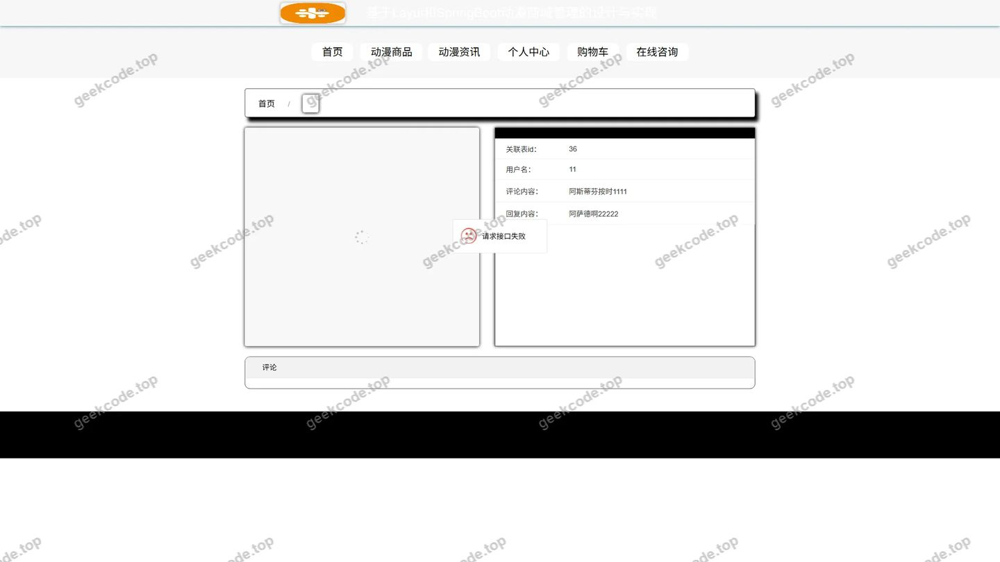</a>

<h4>前台-在线咨询</h4>

<a href="https://geekcode.top/archives/%E5%9F%BA%E4%BA%8ELayui%E5%92%8CSpringBoot%E5%8A%A8%E6%BC%AB%E5%95%86%E5%9F%8E%E7%AE%A1%E7%90%86%E7%9A%84%E8%AE%BE%E8%AE%A1%E4%B8%8E%E5%AE%9E%E7%8E%B0-%E8%AE%BA%E6%96%87?utm_source=github" title="查看完整源码">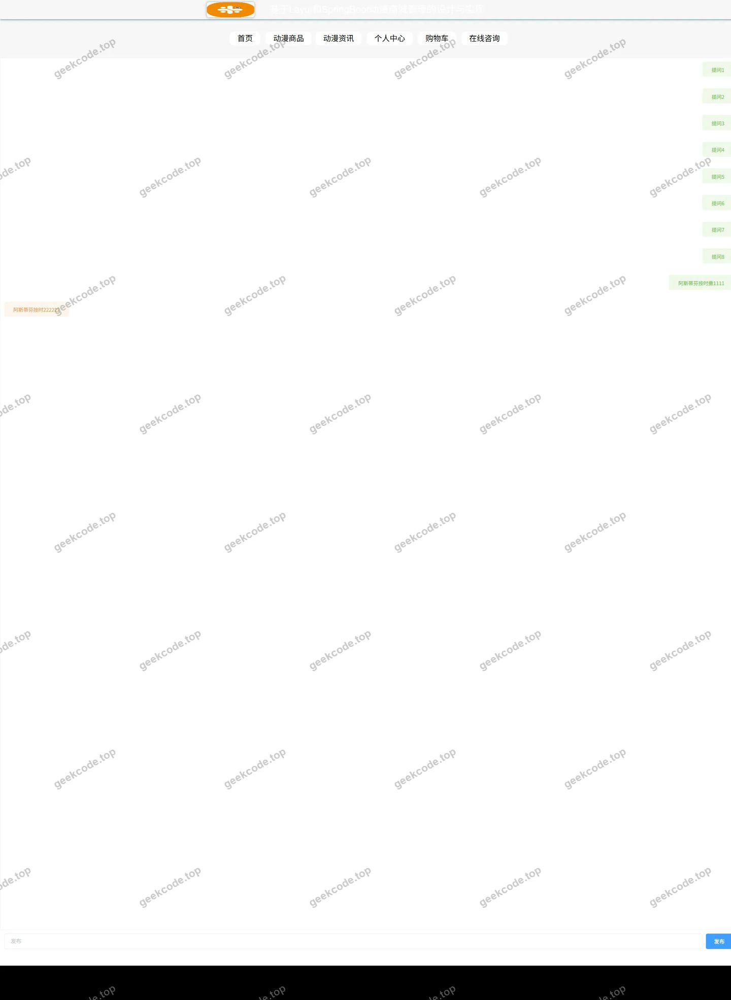</a>

<h3>后台管理端</h3>
<h4>后台-在线客服</h4>

<a href="https://geekcode.top/archives/%E5%9F%BA%E4%BA%8ELayui%E5%92%8CSpringBoot%E5%8A%A8%E6%BC%AB%E5%95%86%E5%9F%8E%E7%AE%A1%E7%90%86%E7%9A%84%E8%AE%BE%E8%AE%A1%E4%B8%8E%E5%AE%9E%E7%8E%B0-%E8%AE%BA%E6%96%87?utm_source=github" title="查看完整源码">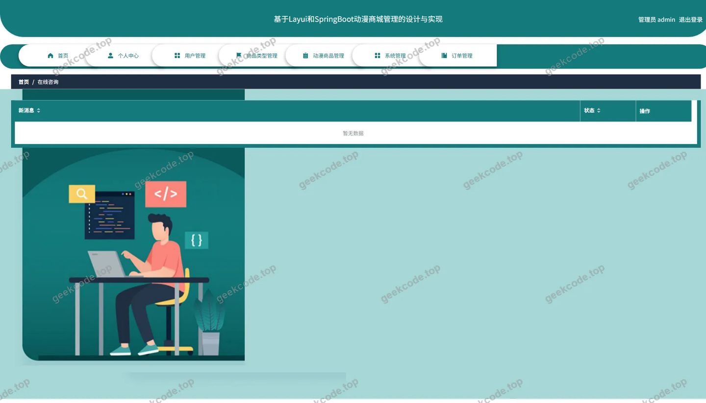</a>

<h4>后台-系统配置</h4>

<a href="https://geekcode.top/archives/%E5%9F%BA%E4%BA%8ELayui%E5%92%8CSpringBoot%E5%8A%A8%E6%BC%AB%E5%95%86%E5%9F%8E%E7%AE%A1%E7%90%86%E7%9A%84%E8%AE%BE%E8%AE%A1%E4%B8%8E%E5%AE%9E%E7%8E%B0-%E8%AE%BA%E6%96%87?utm_source=github" title="查看完整源码">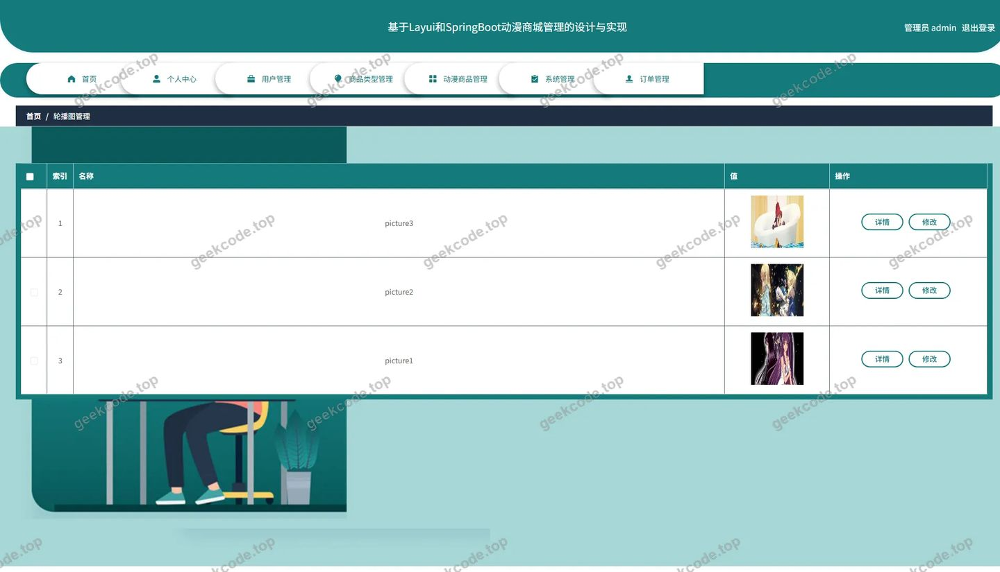</a>

<h4>后台-动漫商品评论</h4>

<a href="https://geekcode.top/archives/%E5%9F%BA%E4%BA%8ELayui%E5%92%8CSpringBoot%E5%8A%A8%E6%BC%AB%E5%95%86%E5%9F%8E%E7%AE%A1%E7%90%86%E7%9A%84%E8%AE%BE%E8%AE%A1%E4%B8%8E%E5%AE%9E%E7%8E%B0-%E8%AE%BA%E6%96%87?utm_source=github" title="查看完整源码">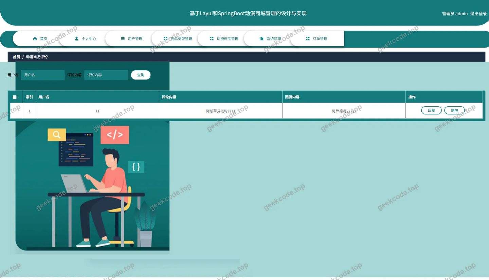</a>

<h4>后台-动漫商品</h4>

<a href="https://geekcode.top/archives/%E5%9F%BA%E4%BA%8ELayui%E5%92%8CSpringBoot%E5%8A%A8%E6%BC%AB%E5%95%86%E5%9F%8E%E7%AE%A1%E7%90%86%E7%9A%84%E8%AE%BE%E8%AE%A1%E4%B8%8E%E5%AE%9E%E7%8E%B0-%E8%AE%BA%E6%96%87?utm_source=github" title="查看完整源码">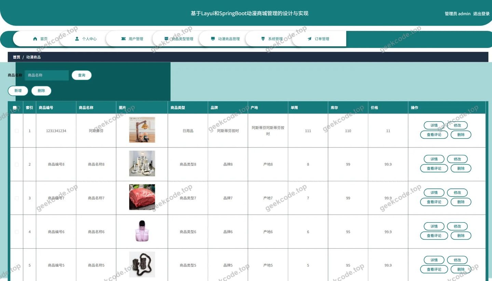</a>

<h4>后台首页</h4>

<a href="https://geekcode.top/archives/%E5%9F%BA%E4%BA%8ELayui%E5%92%8CSpringBoot%E5%8A%A8%E6%BC%AB%E5%95%86%E5%9F%8E%E7%AE%A1%E7%90%86%E7%9A%84%E8%AE%BE%E8%AE%A1%E4%B8%8E%E5%AE%9E%E7%8E%B0-%E8%AE%BA%E6%96%87?utm_source=github" title="查看完整源码">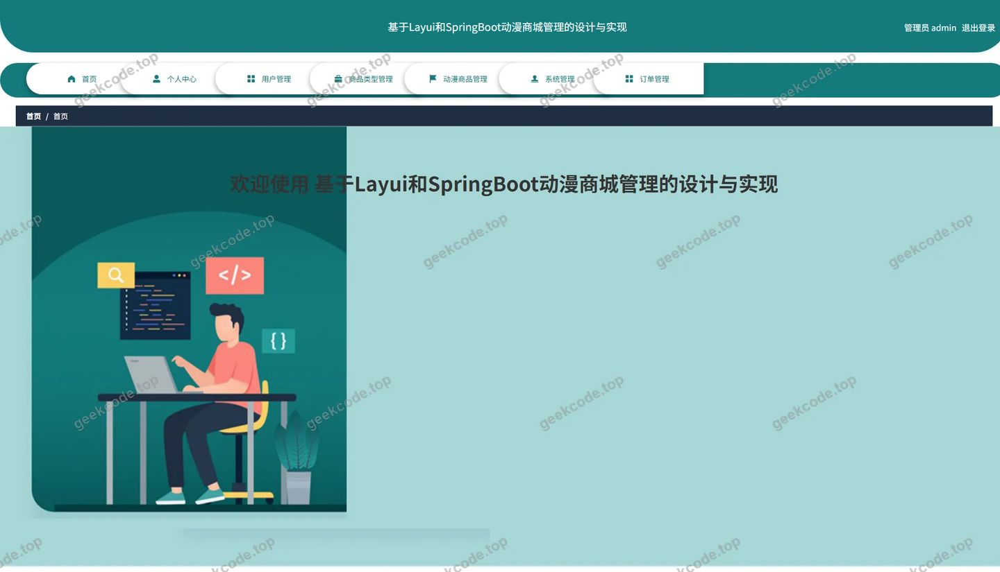</a>

<h4>后台-登录</h4>

<a href="https://geekcode.top/archives/%E5%9F%BA%E4%BA%8ELayui%E5%92%8CSpringBoot%E5%8A%A8%E6%BC%AB%E5%95%86%E5%9F%8E%E7%AE%A1%E7%90%86%E7%9A%84%E8%AE%BE%E8%AE%A1%E4%B8%8E%E5%AE%9E%E7%8E%B0-%E8%AE%BA%E6%96%87?utm_source=github" title="查看完整源码">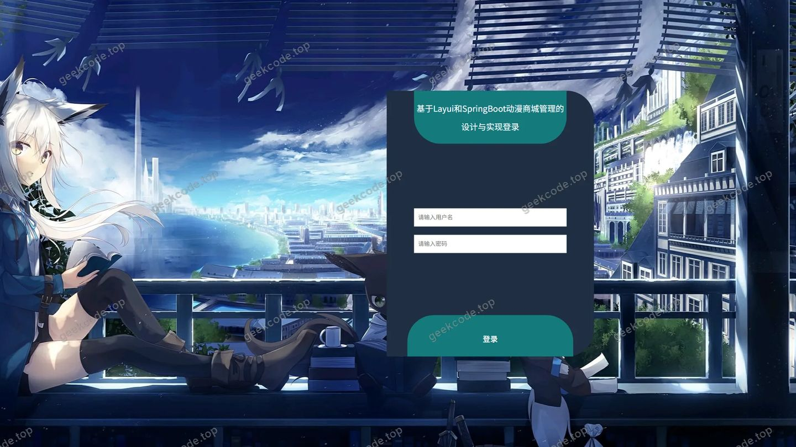</a>

<h4>后台-公告信息</h4>

<a href="https://geekcode.top/archives/%E5%9F%BA%E4%BA%8ELayui%E5%92%8CSpringBoot%E5%8A%A8%E6%BC%AB%E5%95%86%E5%9F%8E%E7%AE%A1%E7%90%86%E7%9A%84%E8%AE%BE%E8%AE%A1%E4%B8%8E%E5%AE%9E%E7%8E%B0-%E8%AE%BA%E6%96%87?utm_source=github" title="查看完整源码">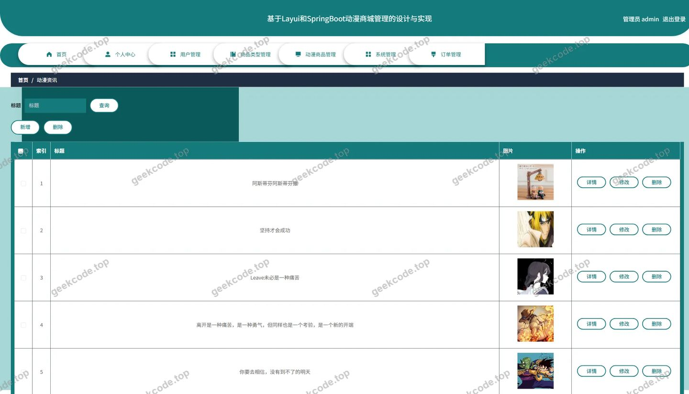</a>

<h4>后台-订单-状态</h4>

<a href="https://geekcode.top/archives/%E5%9F%BA%E4%BA%8ELayui%E5%92%8CSpringBoot%E5%8A%A8%E6%BC%AB%E5%95%86%E5%9F%8E%E7%AE%A1%E7%90%86%E7%9A%84%E8%AE%BE%E8%AE%A1%E4%B8%8E%E5%AE%9E%E7%8E%B0-%E8%AE%BA%E6%96%87?utm_source=github" title="查看完整源码">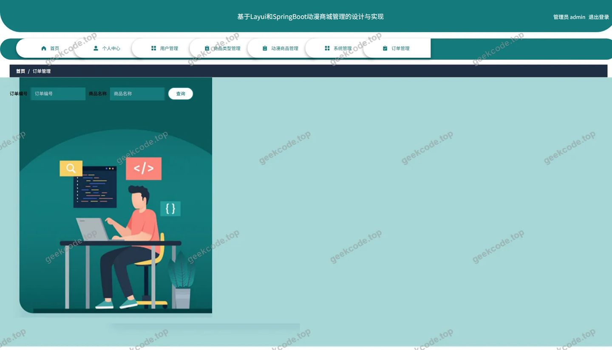</a>

<h4>后台-商品类型</h4>

<a href="https://geekcode.top/archives/%E5%9F%BA%E4%BA%8ELayui%E5%92%8CSpringBoot%E5%8A%A8%E6%BC%AB%E5%95%86%E5%9F%8E%E7%AE%A1%E7%90%86%E7%9A%84%E8%AE%BE%E8%AE%A1%E4%B8%8E%E5%AE%9E%E7%8E%B0-%E8%AE%BA%E6%96%87?utm_source=github" title="查看完整源码">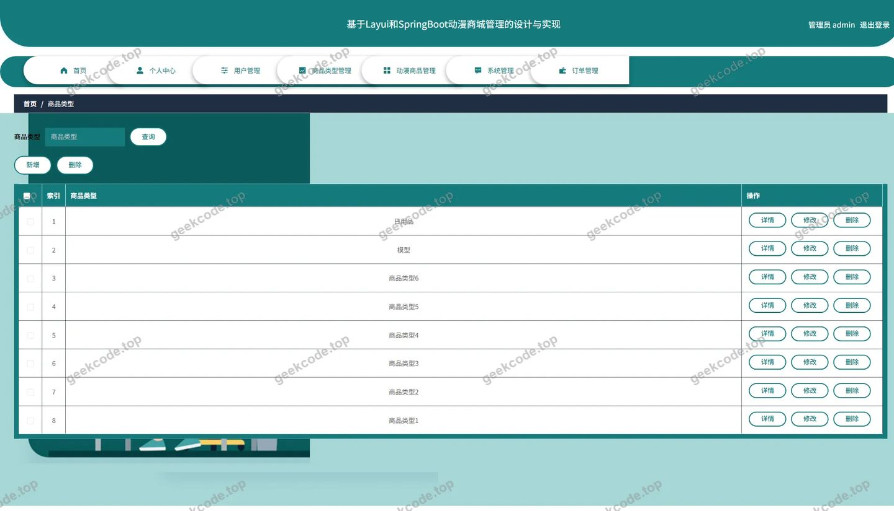</a>

---

## 获取完整源码

| 项目 | 说明 |
| --- | --- |
| 项目名 | 基于Layui和SpringBoot动漫商城管理的设计与实现--论文 |
| 运行截图 | 本文 26 张（站点带水印原图，仓库 `images/` 目录） |
| 完整源码 | [https://geekcode.top/archives/%E5%9F%BA%E4%BA%8ELayui%E5%92%8CSpringBoot%E5%8A%A8%E6%BC%AB%E5%95%86%E5%9F%8E%E7%AE%A1%E7%90%86%E7%9A%84%E8%AE%BE%E8%AE%A1%E4%B8%8E%E5%AE%9E%E7%8E%B0-%E8%AE%BA%E6%96%87?utm_source=github](https://geekcode.top/archives/%E5%9F%BA%E4%BA%8ELayui%E5%92%8CSpringBoot%E5%8A%A8%E6%BC%AB%E5%95%86%E5%9F%8E%E7%AE%A1%E7%90%86%E7%9A%84%E8%AE%BE%E8%AE%A1%E4%B8%8E%E5%AE%9E%E7%8E%B0-%E8%AE%BA%E6%96%87?utm_source=github) |
| 咨询微信 | **ir9372**（备注：jingpin-yuanma） |
| 更多项目 | [极客代码 geekcode.top](https://geekcode.top/?utm_source=github) |

> 需要源码、部署、改配置、跑不起来等问题，加微信 ir9372 沟通，说明项目名即可。
